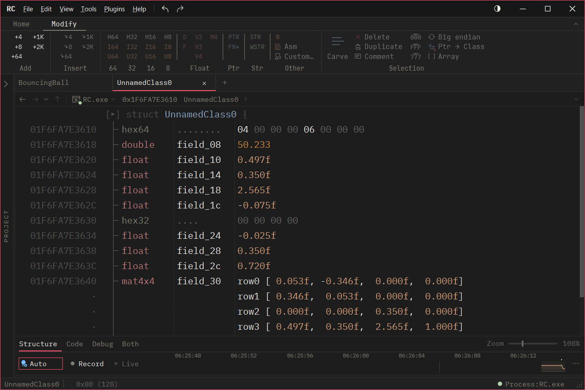
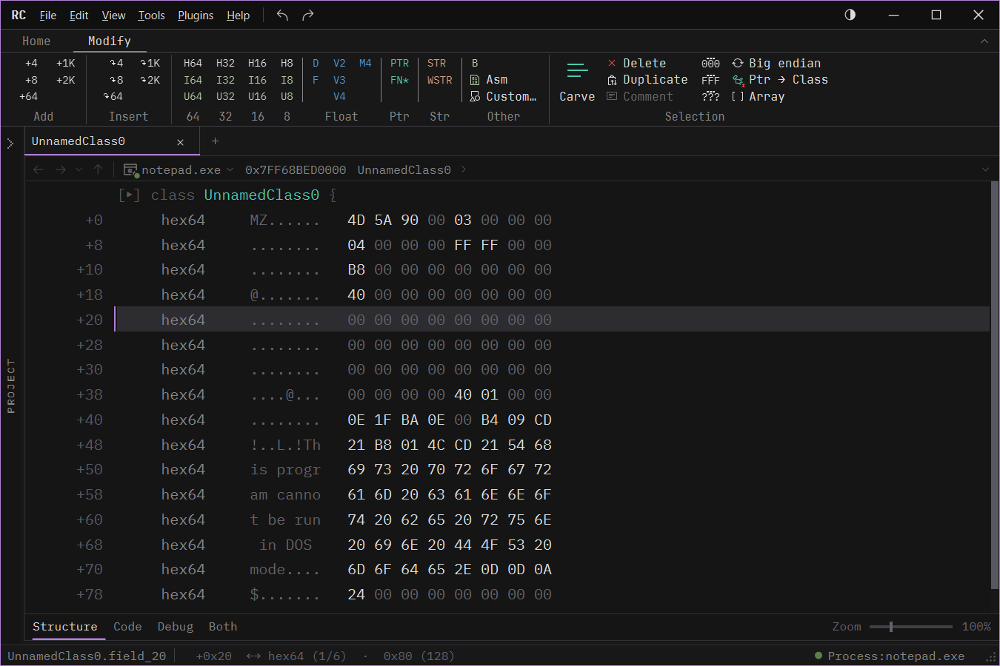
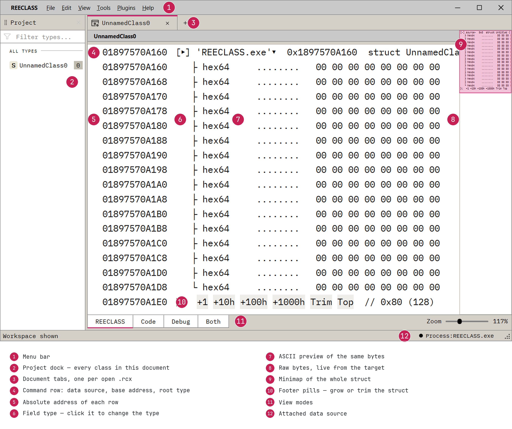
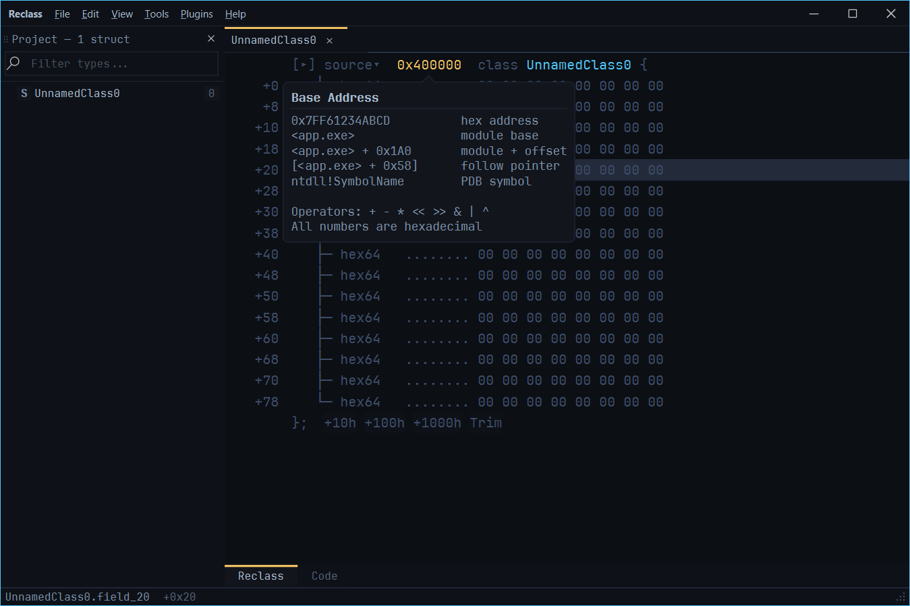
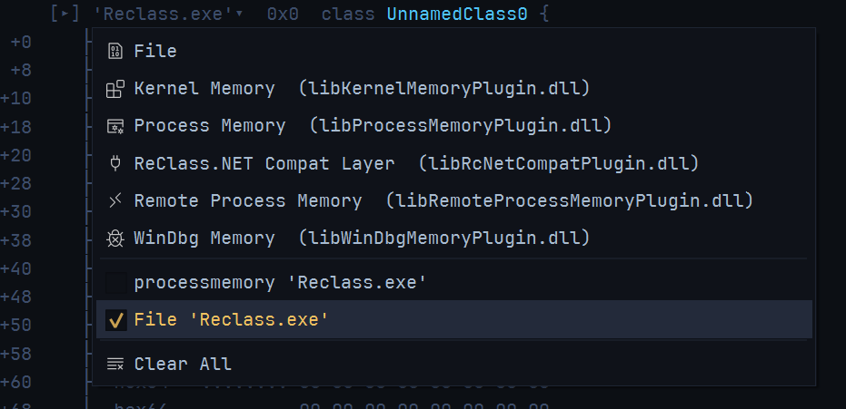
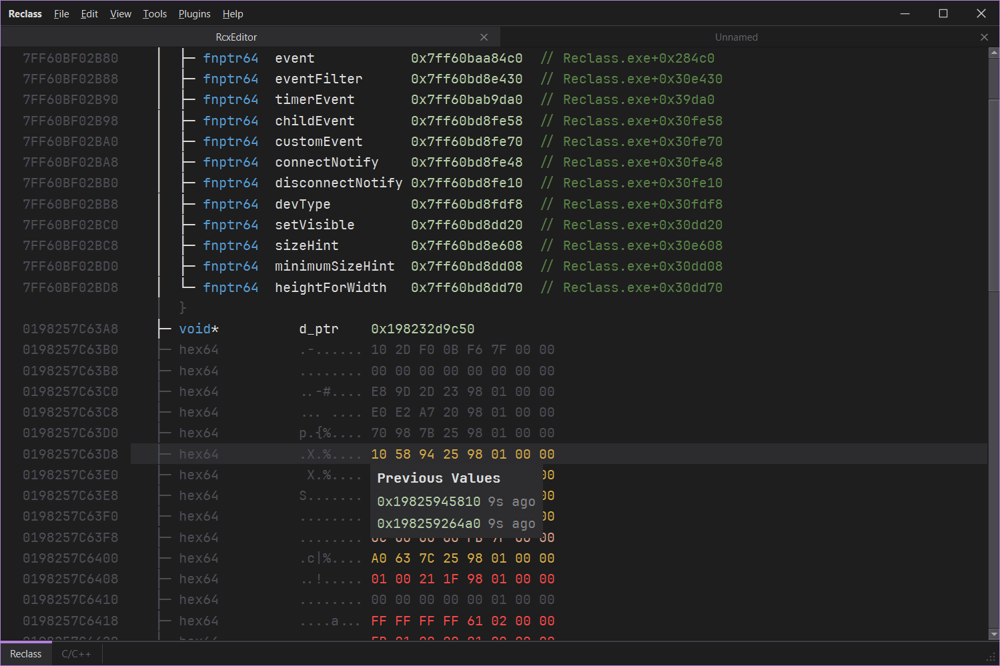
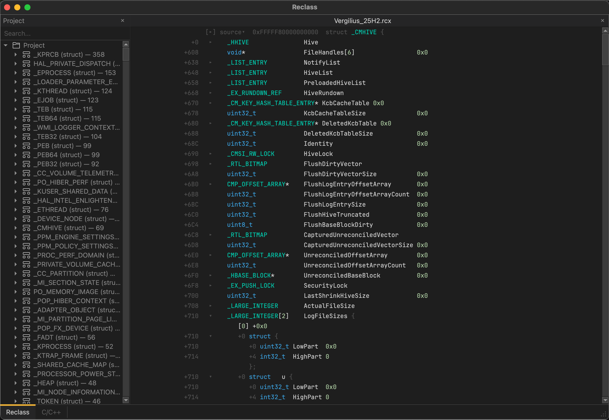
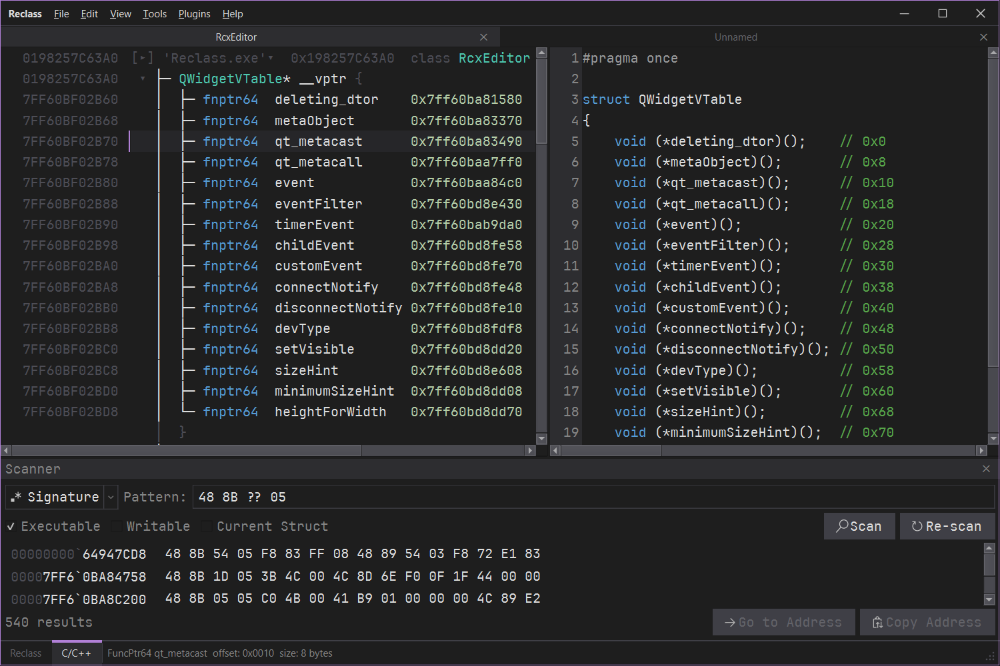
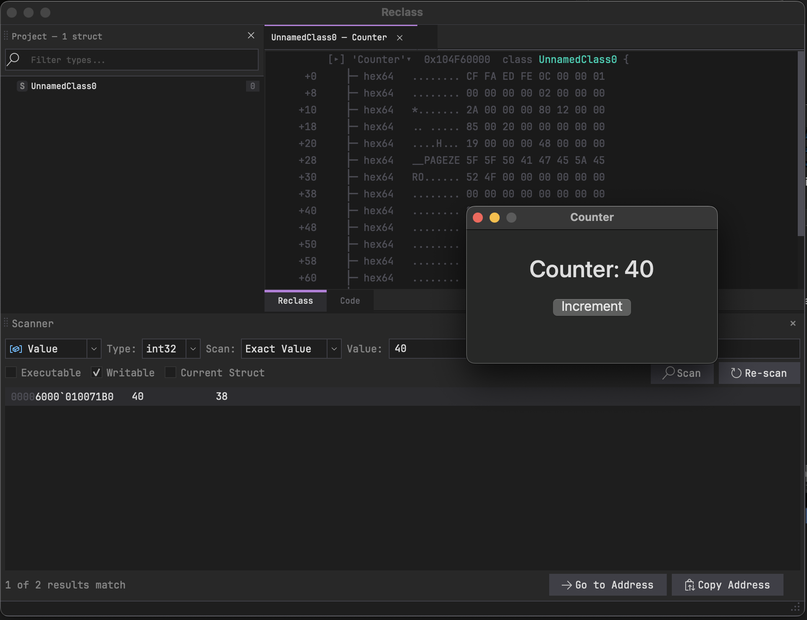

<div align="center">

<picture>
  <source media="(prefers-color-scheme: dark)" srcset="docs/RECLASS_LIGHTMODE.svg" height="170">
  
</picture>

[](https://github.com/IChooseYou/Reclass/actions/workflows/build.yml)
[](LICENSE)
[](https://github.com/IChooseYou/Reclass/releases)
[]()

</div>



















## Recording and timeline

Auto/Cancel, Record/Stop, Live, and options share the fixed-height strip below each
document. F9 starts or stops capture; Ctrl+End returns to live values. Recording
uses a fixed 30-second view, so existing history keeps its scale as data arrives.
Wheel to zoom, Shift+Wheel or middle-drag to pan, and drag to inspect history
(Ctrl snaps to a change). Live resumes following after a pan. Double-click or
choose Show Whole Recording to frame the retained history explicitly.

The strip's time ruler, capture gaps, and selected-field markers use the same
mapping as scrubbing. Hiding it preserves history; starting capture or entering
history reveals the controls again. Recording changes project history, not
target memory.

## Automatic type recovery through MCP

With a structure open, click **Auto** in the bottom strip or press **Ctrl+F9**.
Click **Cancel** to stop analysis. Progress is in the button's tooltip and
**Auto details…** in the options menu, where long messages wrap and scroll.
No progress text consumes address-bar or graph width.

Files and recorded frames use snapshot analysis without requiring a live process.
Live AUTO reuses this class's recorded history, then starts a short recording if
more evidence is needed. It stops only a recording it started; your own recording
keeps running. Captured history stays available for inspection and future AUTO
runs. Requested additional observations come from new captures. Repeating reads
of a fixed snapshot is not treated as new evidence.

It starts the existing MCP server if needed and analyzes evidence in the
background. There is no separate chat command to type, bundled model, model
API key, Python runtime, or decompiler to install.

AUTO has three evidence levels. Matching executable/PDB identity is
`authoritative`. Dynamic IEEE floats/doubles can become `high` only after at
least eight fully readable observations, meaningful value changes, natural
alignment, integer-counter rejection, and competing-lane checks. A pointer can
become `high` only when it is consistent across the available samples, aligned,
successfully probed, and lands in an enumerated readable non-executable region.
Unchanged floats can also become `high` from a readable snapshot when an
adjacent established float or a pair containing a short-decimal float constant
supports the interpretation. Existing float/vector/matrix fields provide
read-only context on subsequent runs. Affine 4x4 matrices require a consistent
homogeneous signature and a non-degenerate, approximately orthogonal basis;
this accounts for their constant zero and one lanes. Overlapping matrix
interpretations, isolated zeros, and unsupported constants stay unresolved.
Everything else remains a `hypothesis`. AUTO applies only the first two levels. It recovers
primitive representations without inventing semantic names, signedness, vector
groupings, arrays, enums, or pointee types. Ambiguous bytes stay hex.

For additional analysis, a connected client can advertise the
[MCP sampling capability](https://modelcontextprotocol.io/specification/2024-11-05/client/sampling)
in the negotiated 2024-11-05 protocol. Pressing AUTO then sends the bounded
evidence over that existing connection automatically. The model receives both
applicable candidates and competing hypotheses. It may select a non-overlapping
applicable subset, abstain, or request another 8–64 observation pass with optional
instruction addresses. RC returns the new evidence in another sampling request,
for at most four model rounds. Model output cannot promote a hypothesis, invent
names or types, or bypass native validation. RC re-reads memory and reruns the
automatic gate before applying one undoable edit. Malformed replies are retried
within the same bound; disconnects fall back to the native conservative layout.
If current bytes contradict an AUTO field, that field remains raw while the
validated remainder can be applied together. Manual proposals still fail as a
whole when their fresh validation fails. Recorded-frame analysis stays bound to
that immutable frame rather than reading current process bytes.

MCP sampling is optional. With no sampling-capable client, AUTO still performs
the native temporal, pointer, and PDB analysis and applies its conservative
layout. Starting the MCP server opens the endpoint; it does not itself start or
bundle a model.

Recovery preserves typed fields, annotations, custom field names, and unresolved
bytes. It can split hex rows, combine bytes across rows, and create nested structs
or uniform arrays. Applying a proposal changes the project layout, never target
memory, and creates one undo step. Fresh reads and a source/tree revision check
run before every validation and application. Undo is available in the editor and
through the existing MCP `ui.action` tool.

The lower-level MCP analysis workflow also exposes **unverified hypotheses** for
explicit investigation. It can split rows and construct structs/arrays; these
operations are broader than the strict AUTO button's policy:

1. Call `analysis.infer_types` with `{"action":"start"}`. Optional arguments are
   `parentId`, `offset`, `length`, `samples`, `intervalMs`, `codeAddresses`, and
   `tabIndex`. Select an embedded struct or open a pointed-to struct as the view
   root first. Addresses and IDs are strings; offsets and lengths are byte counts.
   Set `automatic:true` to enforce the same authoritative/high-confidence policy
   as the button.
2. Poll `{"action":"status","jobId":"..."}` after `pollAfterMs` until ready.
   Read candidate pages using `cursor`/`nextCursor`. The first page includes
   `suggestedFields`, unresolved ranges, pointer/RTTI evidence, and code context.
   Use existing `symbols.load`, `symbols.lookup`, and `symbols.importType` tools
   when authoritative PDB types are available.
3. Call `tree.apply` with the proposal below, then poll the job's status for
   `application.valid`. Review the evidence before choosing candidates;
   `suggestedFields` is a starting point, not an instruction to accept every field.
4. Submit the same proposal with `validateOnly:false`, then poll for
   `application.applied`. A successful tool call that returns `verifying` means
   work has started, not that the layout has already changed.

```json
{
  "resolution": {
    "jobId": "<returned job ID>",
    "revision": "<returned revision>",
    "fields": [{"candidateId": "<returned candidate ID>"}],
    "validateOnly": true
  }
}
```

Each leaf cites a returned `candidateId` and may include a `name`. Pointer leaves
may include `refId` for an existing struct. Groups use
`{"kind":"Struct","offset":0,"size":8,"fields":[...]}` or
`{"kind":"Array","offset":0,"size":8,"elements":["<candidate ID>","..."]}`.
**All proposal offsets, including nested groups, are relative to the originally
selected parent.** Groups must cover their declared range completely; array
elements must be contiguous candidates of the same fixed-size type. Unsupported
overrides, overlaps, protected fields, or stale observations reject the proposal.

Jobs default to 16 observations at 100 ms; static sources use one observation.
Limits are 4096 bytes per job, 64 observations, four retained jobs, 16 code
addresses, and 512 proposed nodes with at most four nested group levels. Jobs
expire after ten minutes and survive client reconnection while ReClass stays
open; use `action:list` to find them or `action:cancel` to stop one. Legacy calls
using `nodeIds` without `action` retain their existing response format.

Candidate scores are heuristic rankings, not correctness probabilities. Memory
polling is not an atomic snapshot or execution trace. Instruction context does
not by itself establish which register points to the observed object. Original
names, signedness, buffer capacity, and semantic types can remain ambiguous;
the assistant should retain unknown bytes when evidence cannot distinguish them.

### Runtime regression test

`python tests/test_auto_resolution_runtime.py --build-dir build` starts the real
application and stdio MCP bridge on a private pipe, with isolated settings and
Qt's offscreen platform. It tests strict rejection, model replies using a
controlled sampling client, cancellation, disconnects, and a known-layout live
process with matching/mismatched PDBs. The fixture needs the Windows MSVC build
tools; Python and MSVC are test dependencies only. Logs remain under
`build/mcp-runtime-*`. The test stops only the processes it launched.

The native UI suite `test_timeline_strip` checks Auto/Cancel, long status text,
fixed geometry, recording controls and both themes. `test_editor` verifies that
AUTO no longer consumes address-bar width. Run these with
`QT_QPA_PLATFORM=offscreen` and `QT_QPA_PLATFORM_PLUGIN_PATH` pointing to the Qt
platform plugins directory to avoid opening windows.
